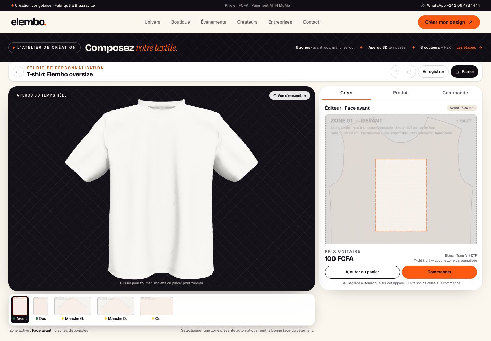
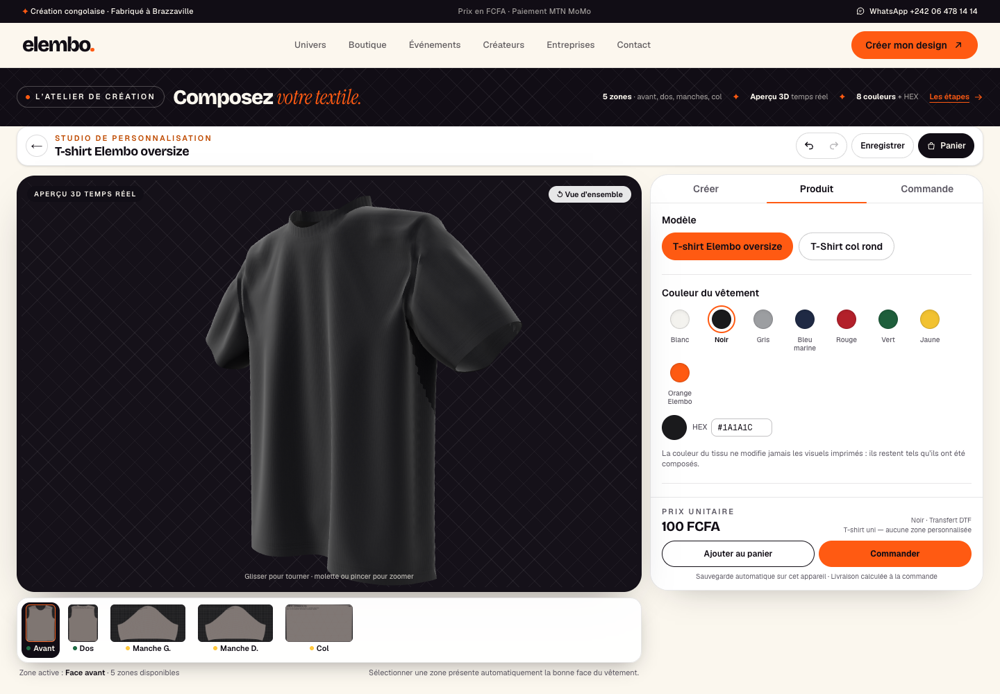
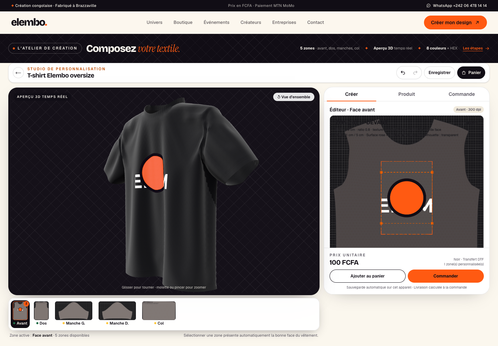
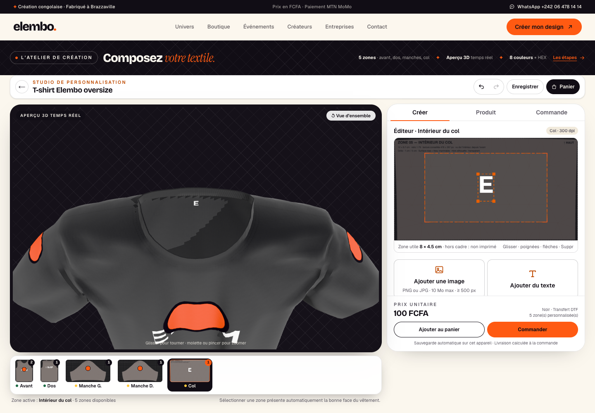
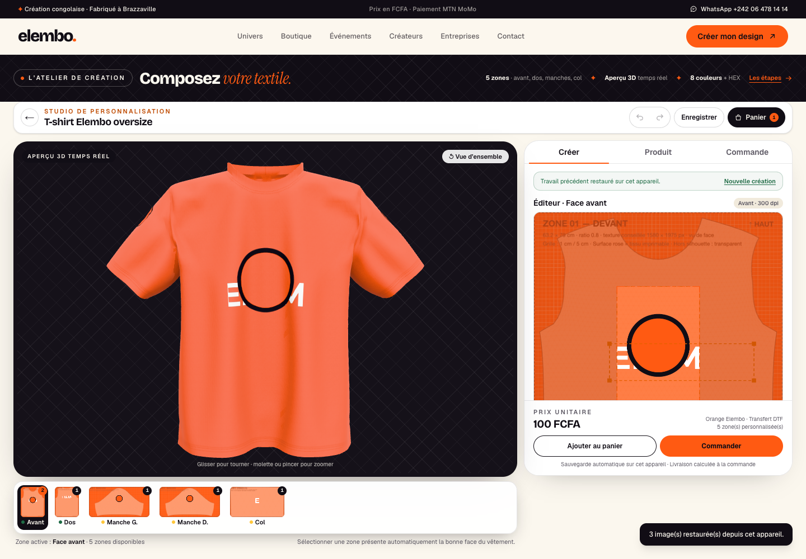
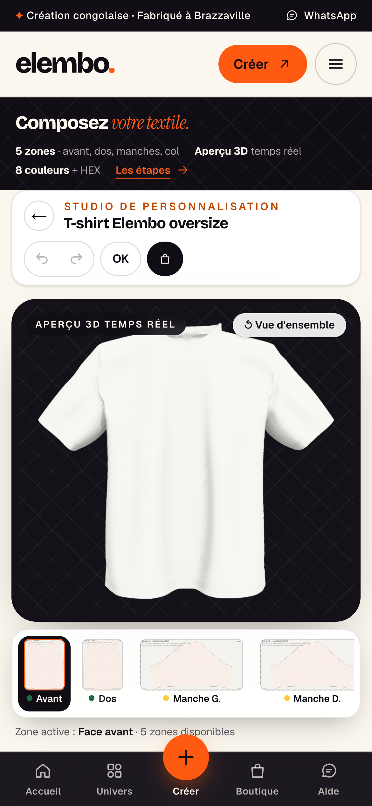
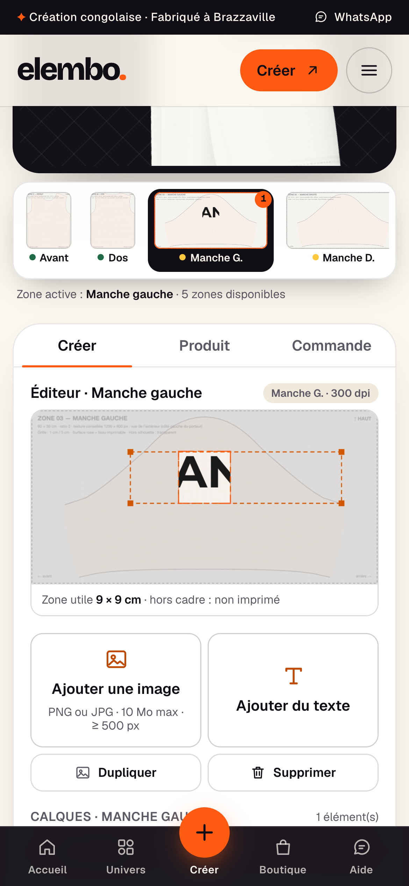

# Intégration du T-shirt 3D Elembo à cinq zones — documentation technique

**Projet** : Elembo, configurateur textile 3D (Next.js 16.3.6, React 19.2.8, React Three Fiber 9.8.1, three 0.186.1, Zustand 5.0.15).
**Objet** : état **livré** de la mission 02 — intégration du modèle `elembo-tshirt` à cinq zones d'impression dans le configurateur, profils de production, éditeur, persistance, panier et export nommé.
**Date des constats** : 12 novembre 2026. **Document** : documentation d'après intervention, à lire avec deux documents de référence :

| Document | Nature | Rapport au présent document |
|---|---|---|
| [`docs/audit-configurateur-tshirt.md`](audit-configurateur-tshirt.md) | audit **d'avant intervention** (état figé au 12/11/2026 14:50, HEAD `917dc94`) | Il décrit ce qui **manquait** avant la mission (pas de technique `zones`, pas d'historique, pas de panier, `MAX_FICHIERS = 6`…). Le présent document décrit ce qui est **livré** ; quand les deux diffèrent, c'est ici l'état courant. |
| [`assets/3d/elembo-tshirt/integration-guide.md`](../assets/3d/elembo-tshirt/integration-guide.md) | guide du modèle fourni par la génération Blender | Référence **du modèle** (conventions, UV, matériaux, régénération). Son §8 décrit le configurateur tel qu'il était avant la mission ; l'intégration qui y était proposée est désormais faite, et c'est le présent document qui fait foi pour l'application. |

Aucun déploiement n'a été effectué, aucun commit n'a été créé dans le cadre de cette documentation. Le code n'est modifié par aucun des documents produits ici.

---

## 1. Objectif et périmètre

Le configurateur existant (une face avant / une face arrière, deux techniques historiques) est **étendu**, pas remplacé :

- **nouvelle technique `zones`** : le GLB Elembo expose cinq surfaces d'impression indépendantes (avant, dos, manche gauche, manche droite, intérieur du col), chacune avec son maillage, son matériau et ses UV (`src/lib/products/catalog.ts:8-25,76-88`) ;
- **conservation stricte des techniques `uv` et `decal`** : le second T-shirt fournisseur et le placeholder restent rendus par le même composant, inchangé (`src/components/configurator/ProductModel.tsx:3-24` aiguille ; `LegacyProductModel.tsx:5-12` décrit les deux techniques conservées) ;
- **éditeur 2D** de la zone active avec gestes souris **et** tactile, historique annuler/rétablir, calques, duplication ;
- **procédés de production** sélectionnables, avec dimensions réellement imprimables et statuts honnêtes ;
- **persistance locale** (brouillon, créations, panier) et **page `/panier`** ;
- **export production** nommé par zone, à la densité du procédé, distinct de l'aperçu 3D.

Ce qui est **préservé sans régression** : catalogue des produits historiques (`tshirt-alt`, placeholder), studio 2D `/studio`, tunnel de paiement MTN MoMo et ses routes, grille tarifaire (`tarifs/grille.json`), validation d'upload (`src/lib/validate.ts`), 17 polices locales. Les deux techniques historiques restent couvertes par leurs tests (voir §11).

**Captures de l'état livré** (12/11/2026, serveur de développement, Chrome — `docs/captures/`) :

| Capture | Ce qu'elle montre |
|---|---|
|  | arrivée dans le studio, GLB chargé, cinq zones disponibles |
|  | couleur du tissu appliquée sans toucher aux visuels |
|  | image PNG transparente posée sur la face avant |
|  | les cinq zones portent chacune un visuel distinct |
|  | brouillon restauré après rechargement (images ré-attachées) |
|  | rendu mobile 390 × 844 : rail de zones et actions visibles |
|  | édition au doigt sur la manche gauche |

---

## 2. Le modèle 3D livré

**Fichier** : `public/models/elembo-tshirt/elembo-tshirt.glb` — 2 470 168 octets (≈ 2,4 Mo), dont 2 456 412 octets de données binaires (géométrie et textures) et 13 728 octets de JSON ; 40 600 triangles. Pas de Draco, ni animation, ni caméra, ni lumière. Extensions déclarées : `KHR_texture_transform` (requise), `KHR_materials_sheen`, `KHR_materials_specular` (`scripts/glb-zones.mjs` ; `tests/elemboModel.test.ts:101-114`).

**Conventions glTF** (guide §2, vérifiées dans le fichier) : unités **mètres**, **+Y** vers le haut, **+Z** devant, origine au centre de la boîte englobante ; vêtement de 0,82 × 0,75 × 0,18 m.

**Hiérarchie et noms réels** — lus par `node scripts/glb-zones.mjs` (sortie JSON) et contrôlés par les tests :

| Nœud GLB | Rôle | Matériau |
|---|---|---|
| `ELEMBO_TSHIRT` | racine ; `extras` : `elembo_version`, `units: "meters"`, `colors` (8), `fabric_materials` | — |
| `TSHIRT_BODY` | tissu, **deux primitives** → en Three.js un groupe avec deux matériaux | `FABRIC` (corps) + `FABRIC_RIB` (col côtes) |
| `TSHIRT_FRONT_PRINT` | zone avant | `PRINT_FRONT` |
| `TSHIRT_BACK_PRINT` | zone dos | `PRINT_BACK` |
| `TSHIRT_LEFT_SLEEVE_PRINT` | manche gauche du porteur | `PRINT_LEFT_SLEEVE` |
| `TSHIRT_RIGHT_SLEEVE_PRINT` | manche droite du porteur | `PRINT_RIGHT_SLEEVE` |
| `TSHIRT_COLLAR_PRINT` | intérieur du col | `PRINT_COLLAR` |

**Jeux d'UV** : les surfaces d'impression portent `TEXCOORD_0` (**UV de la zone**, 0..1, isotrope) **et** `TEXCOORD_1` (**atlas tissu** : maille et occlusion). La maille est répétée par `KHR_texture_transform` (motif de 2 cm, géré nativement par `GLTFLoader`). La conséquence pour l'application est capitale : `flipY = false` (origine glTF en haut à gauche), sinon chaque visuel apparaît retourné verticalement (`src/lib/three/textures.ts:139-147,167`).

**Dimensions physiques et repères** (source unique des dimensions : mesurées sur le GLB par `scripts/glb-zones.mjs`, recopiées dans `src/lib/products/catalog.ts:161-195`, contrôlées par `tests/elemboModel.test.ts:125-169`) :

| Zone | Maillage | Texture | Ratio L/H | Repère mesuré | Zone DTF |
|---|---|---|---|---|---|
| Avant | `TSHIRT_FRONT_PRINT` | 63,2 × 79 cm | 0,800 | creux du col à 11,85 cm | 21 × 30 cm |
| Dos | `TSHIRT_BACK_PRINT` | 62,4 × 78 cm | 0,800 | creux du col à 3,38 cm | 25 × 32,4 cm |
| Manche gauche | `TSHIRT_LEFT_SLEEVE_PRINT` | 60 × 30 cm | 2,000 | tête de manche à 1,08 cm | 9 × 9 cm |
| Manche droite | `TSHIRT_RIGHT_SLEEVE_PRINT` | 60 × 30 cm | 2,000 | tête de manche à 1,08 cm | 9 × 9 cm |
| Col | `TSHIRT_COLLAR_PRINT` | 12 × 6,7 cm | 1,791 | pas d'axe médian exploitable ; repère « haut » | 8 × 4,5 cm |

**Conventions d'exploitation** : la couleur du vêtement est portée **uniquement** par `FABRIC` et `FABRIC_RIB`, retrouvés **par nom de matériau** (jamais par nom de maillage, car `TSHIRT_BODY` devient un groupe) ; les surfaces d'impression sont des copies de la surface du tissu décalées de 0,4 mm, donc l'encre suit les plis (`src/lib/three/zones.ts:45-114`) ; les zones ne projettent et ne reçoivent pas d'ombre (`castShadow = false`, `receiveShadow = false`) pour éviter l'acné d'ombre sur le tissu (`src/lib/three/zones.ts:76-82`) ; le `polygonOffset` négatif évite le scintillement à 0,4 mm (`src/lib/three/zones.ts:108-112`).

⚠️ Les `recommended_texture_px` des `extras` du GLB (≈ 50–100 dpi) **ne sont pas** des résolutions d'impression : la production passe toujours par `productionTextureSize()` à la densité du procédé (§9).

---

## 3. Architecture logicielle

**Un seul état, un seul moteur de composition.** Le pipeline est linéaire et sans duplication :

```
Gestes (ZoneEditor, ElementControls)          Panneau (calques, couleur, procédé, commande)
        └──────────────► store Zustand (état unique, une seule source de vérité) ◄──────────┘
                                      │
                     drawComposition() sur un Canvas 2D (moteur unique de placement)
                                      │
        ┌─────────────────────────────┼──────────────────────────────┐
        ▼                             ▼                              ▼
  éditeur 2D (900 px)      CanvasTexture par zone (1024/512)   renderPrintPng (productionTextureSize)
  repères + sélection      → Three.js (affichage seul)         → PNG transparent à la densité procédé
```

- **`src/types/configurator.ts`** — types partagés : `Side` (5 valeurs), `ElementBase`, `ImageElement`, `TextElement`, `ConfiguratorConfig` (`version: 2 | 3`). Le store, le canvas et Three.js consomment ces mêmes types (`src/types/configurator.ts:8-45,47-103,194-204`).
- **`src/lib/products/catalog.ts`** — catalogue : `PrintTechnique = 'uv' | 'decal' | 'zones'`, `PrintArea` (fractions UV + dimensions cm), `ZoneModel` (maillage, `textureCm`, `reperesCm`, `vue`), produit par défaut `tshirt-basic`, `getPrintArea()` et `zoneArea()` qui placent la zone imprimable **dans la texture de la pièce** selon le procédé (`src/lib/products/catalog.ts:35-126,301-349`). `validateProduct()` vérifie qu'aucune zone ne sort de la texture (`:379-421`).
- **`production/profils.json` + `src/lib/products/production.ts`** — procédés et dimensions réellement imprimables (source unique, aucune dimension de production ailleurs) ; helpers `profilParId`, `statutZone`, `empechementsCommande` (§7).
- **`src/stores/configurator-store.ts`** — état unique : `productId`, `color`, `side`, `profileId`, `elements[]`, sélection, historique. **Toute** mutation passe par `clampFor()` (`:197-211`) : un élément ne peut jamais être poussé hors de la zone imprimable du procédé, quelle que soit l'action. Historique : instantanés complets, max 60, fusion des gestes continus sur 600 ms (`:120-133,541-578`). Sérialisation **v3** (zones + `profileId` + `assetId`), une seule implémentation partagée (`:77-118`) ; `loadConfig()` tolère v1/v2 et signale les replis (`:488-535`).
- **`src/lib/three/textures.ts`** — un canvas + une `CanvasTexture` par zone, **créés une fois puis redessinés** (jamais recréés à chaque état) ; `flipY = false`, `sRGB`, filtrage anisotrope ; fonctions `dispose*` au démontage (`:150-216`).
- **`src/lib/three/zones.ts`** — préparation de la scène : clone **profond** de la scène et des matériaux (le cache `useGLTF` est partagé et muter l'original contaminerait les autres instances), repérage des `PRINT_*`, réglage de l'encre mate transparente, application de la couleur aux seuls `FABRIC`/`FABRIC_RIB` (`:17-119`).
- **`src/lib/canvas/design-canvas.ts`** — maths pures testables + rendu : `compositionSize()` (format de l'espace = ratio physique de la texture), `printAreaRect()`, `elementRect()`, `clampElement()`, `elementOverflow()`, `drawComposition()` ; constantes `PREVIEW_TEXTURE_SIZE = 1024`, `PRINT_DPI = 300`, `MAX_PRINT_TEXTURE_SIZE = 4096` (`:18-22,43-71,124-265,413-448,526-533`).
- **`src/lib/canvas/export.ts`** — `renderPrintPng()` : recomposition dans un espace de 2048, recadrage sur la zone, mise à l'échelle du fichier cible ; **jamais une capture du canvas d'aperçu** (`:16-83`).
- **`src/lib/order/order.ts`** — placements en centimètres, fiche de production v2, noms de fichiers par zone (§10).
- **`src/lib/projects/` + `src/lib/storage/`** — persistance locale (§8).
- **`src/components/configurator/*`** — studio : `Configurator.tsx` (coquille), `ZonesProductModel.tsx` (rendu des cinq zones), `ZoneEditor.tsx` (édition), `ZoneRail.tsx`, `ProductionProfileSelector.tsx`, `OrderPanel.tsx`, `ExportPanel.tsx`, `HistoryControls.tsx`, `useProjet.ts`.

**Pourquoi il n'y a pas de duplication de logique.** La composition 2D→3D→export est la même fonction `drawComposition()` et les mêmes maths `elementRect()`/`clampElement()` dans : l'éditeur (`ZoneEditor.tsx:94-108`), la texture 3D de chaque zone (`ZonesProductModel.tsx:111-159`), les vignettes du rail (`ZonePreview.tsx:53-71`), les aperçus de commande (`OrderPanel.tsx:74-93`), l'aperçu de panier (`src/lib/projects/preview.ts:49-100`) et le fichier de production (`src/lib/canvas/export.ts:65-73`). Un visuel ne peut donc pas être différent à l'écran, sur le vêtement et dans le PNG.

**Mise à jour ciblée des textures.** `ZonesProductModel` calcule une signature par zone (éléments de la zone, rectangle imprimable, taille d'espace, version des polices, disponibilité des images) et ne redessine **que les zones dont la signature change** (`ZonesProductModel.tsx:111-159`). Changer une zone ne touche jamais les autres ; changer la couleur ne touche aucune texture.

---

## 4. Zones et caméra

- **Cinq zones ordonnées** : `SIDES = ['front','back','left-sleeve','right-sleeve','collar']`, libellés et noms de fichiers dans `src/types/configurator.ts:12-45`. Un produit plus simple (techniques `uv`/`decal`) n'en expose que deux : `productSides()` (`src/lib/products/catalog.ts:307-312`).
- **Vue par zone** : `ELEMBO_TSHIRT_ZONES[side].vue` donne l'azimut, l'inclinaison polaire, la distance relative et la hauteur de visée (`src/lib/products/catalog.ts:164-195`).

| Zone | azimut | polaire | distance | `cibleY` |
|---|---|---|---|---|
| Avant | 0° | 86° | 1 | — |
| Dos | 180° | 86° | 1 | — |
| Manche gauche | 80° | 72° | 0,62 | 0,22 |
| Manche droite | −80° | 72° | 0,62 | 0,22 |
| Col | 0° | 40° | 0,5 | 0,42 |

- **`CameraRig`** consomme cette vue et anime la caméra en 0,45 s environ (interpolation indépendante du framerate), via l'angle azimutal d'`OrbitControls` — jamais en déplaçant `camera.position` en ligne droite, ce qui passerait par le centre du modèle (`ProductViewer.tsx:41-182`). L'utilisateur reprend la main dès qu'il touche la scène (`:130-139`) ; les contrôles orbitaux restent bornés (`:383-395`). Le bouton « ↺ Vue d'ensemble » remet le cadrage et la face avant (`Configurator.tsx:122-125,193-201`).
- **Sélection indépendante** : `ZoneRail` affiche une **vraie** vignette de chaque zone (même composition que la 3D), le nombre d'éléments et le statut de production (pastille) (`ZoneRail.tsx:37-95`). Changer de zone ne recharge rien : les éléments des autres zones restent en mémoire. L'onglet « Zone du vêtement » de l'éditeur déplace un élément d'une zone à l'autre en le re-bornant dans la nouvelle zone (`store:382-397`).

---

## 5. Éditeur

- **Gestes** : souris **et** tactile passent par les mêmes événements *Pointer* — aucun code parallèle (`ZoneEditor.tsx:1-15`). Glisser = déplacer (`:257-268`) ; poignée bas-droite = redimensionner (une image change d'échelle, un texte change de taille de police) (`:271-281`) ; poignée haute = pivoter (`:284-287`). `setPointerCapture` capture le geste même hors du canvas (`:214-218`).
- **Clavier** : flèches pour affiner (Maj = pas ×5), `Suppr`/`Retour arrière` pour retirer, `Ctrl+D`/`Cmd+D` pour dupliquer (`ZoneEditor.tsx:298-318`). `Ctrl+Z` / `Ctrl+Shift+Z` / `Ctrl+Y` annulent/rétablissent, et sont ignorés quand le focus est dans un champ de saisie (`HistoryControls.tsx:34-56`).
- **Bornage** : `clampElement()` maintient un élément plus petit que la zone entièrement dedans, avec une marge de sécurité de 1,5 % ; un élément plus grand peut glisser mais ce qui dépasse est rogné à l'impression, comme dans la réalité (`design-canvas.ts:197-227`). Le débordement est signalé et corrigeable d'un clic (« Ajuster à la zone », facteur calculé par `elementOverflow()`) (`ElementControls.tsx:241-256,404-419` ; `design-canvas.ts:246-265`).
- **Polices** : 17 familles libres (licence affichée), la police réellement chargée déclenche un redessin (`useElementImages.ts:85-114`). **Images** : PNG/JPG, ≤ 10 Mo, ≥ 500 px (`UploadDesign.tsx:22-49` ; `src/lib/validate.ts:6-8`) ; le PNG transparent est conservé tel quel (alpha dessiné dans le canvas). Le fichier d'origine reste sur l'appareil (IndexedDB, §8).
- **Calques** : liste de la zone active, sélection, visibilité, ordre (`z`), montée/descente (`DesignPanel.tsx` ; `store:408-425`), duplication (décalage de 0,04 et nouvel identifiant) (`store:363-378`), suppression. L'ordre des calques est aussi celui de l'export (`elementsOfSide()` trie par `z`).
- **Historique** : un instantané complet avant chaque action ; les écritures du même geste (glisser, curseur, frappe) sont **fusionnées** sur 600 ms, si bien qu'un geste = un seul « annuler » (`store:131-133,555-562`). Changement de produit = nouveau projet : historique vidé (`store:236-258`).

---

## 6. Couleurs

- **Palette** : 8 couleurs définies par le modèle et recopiées à l'identique dans le catalogue — Blanc `#F4F3EF`, Noir `#1A1A1C`, Gris `#9C9EA1`, Bleu marine `#1F2A44`, Rouge `#B3202A`, Vert `#1E5E3B`, Jaune `#F2C230`, Orange Elembo `#FF5A12` (`src/lib/products/catalog.ts:210-220`). Le test du GLB vérifie que ces 8 valeurs sont exactement celles des `extras` du fichier (`tests/elemboModel.test.ts:116-122`).
- **Couleur libre** : pipette + saisie HEX normalisée et validée (`ProductColorSelector.tsx:11-65,76-109`) ; le store refuse une valeur invalide (`store:260-264`).
- **Porteur unique** : la couleur est appliquée **uniquement** aux matériaux du tissu (`applyFabricColor()`, `src/lib/three/zones.ts:116-119`, appelé dans `ZonesProductModel.tsx:106-109`). Les matériaux d'impression sont forcés en blanc (`src/lib/three/zones.ts:101`), et les textures de zone sont composées avec `baseColor: null` — la couleur du vêtement n'est **jamais peinte dedans** (`ZonesProductModel.tsx:147-151`).
- **Preuve** : les contrôles E2E « changer la couleur ne modifie aucune texture de zone » et « changer la couleur du tissu ne touche pas les visuels imprimés » comparent les pixels alpha des cinq textures avant/après (`scripts/e2e/studio.mjs`, familles listées §11). Limite connue : le gris chiné est rendu par une couleur unie, pas par une texture chinée (guide §11).

---

## 7. Procédés de production

**Source unique** : `production/profils.json` (version 1, mise à jour 2026-11-12). Lue par `src/lib/products/production.ts`, jamais recopiée ailleurs. Extrait (procédé DTF) :

```json
{
  "version": 1,
  "parDefaut": "dtf",
  "profils": [{
    "id": "dtf", "nom": "Transfert DTF", "statut": "disponible", "dpi": 300,
    "zones": {
      "front":  { "statut": "disponible", "largeurCm": 21, "hauteurCm": 30, "repere": "col", "hautCm": 7 },
      "back":   { "statut": "disponible", "largeurCm": 25, "hauteurCm": 32.4, "repere": "col", "hautCm": 7 },
      "left-sleeve": { "statut": "a-valider", "largeurCm": 9, "hauteurCm": 9, "repere": "epaule", "hautCm": 6, "note": "…" },
      "collar": { "statut": "a-valider", "largeurCm": 8, "hauteurCm": 4.5, "repere": "haut", "hautCm": 1, "note": "…" }
    }
  }]
}
```

| Statut | Sens |
|---|---|
| `disponible` | commandable et fabriqué avec ce procédé |
| `a-valider` | composable et prévisualisable, **commande bloquée** tant que l'atelier n'a pas confirmé |
| `indisponible` | non proposé (le procédé, lui, peut rester sélectionnable pour comparer les zones) |

**Statut effectif** : le moins favorable entre le procédé et la zone — un procédé `indisponible` rend toutes ses zones indisponibles (`src/lib/products/production.ts:64-78`). Un identifiant inconnu retombe sur le procédé par défaut, sans planter (`:55-62`).

| Procédé | Statut | dpi | Zones |
|---|---|---|---|
| Transfert DTF | **disponible** | 300 | avant/dos disponibles ; manches et col `a-valider` |
| Flex / vinyle découpé | `a-valider` | 300 | avant/dos/manches `a-valider` (28 × 35 cm), col `indisponible` |
| Impression directe DTG | `indisponible` | 300 | zones configurées 35 × 40 cm en avant/dos, mais procédé indisponible |
| Sublimation intégrale | `indisponible` | 150 | zones `pleine: true` (toute la pièce), procédé indisponible |

**Règle de blocage** : `empechementsCommande(profil, zonesPersonnalisées)` ne bloque **que** les zones réellement personnalisées (une zone `a-valider` vide ne gêne pas), et rend un motif lisible par zone (`src/lib/products/production.ts:85-125`). L'interface de commande affiche ces motifs et désactive le bouton de paiement tant qu'il en existe (`OrderPanel.tsx:165-172,478-491`). L'export des fichiers reste possible pour permettre à l'atelier de valider un placement — mais la commande, non.

**Limites honnêtes, assumées** : en DTF, les manches et l'intérieur du col sont **bloqués à la commande** jusqu'à validation atelier (taille du plateau de presse, étiquette de col) ; le flex n'est pas validé ; DTG et sublimation sont **indisponibles**. Aucune zone non confirmée ne peut donc être encaissée. Les dimensions sont validées par `validerProfils()` (`src/lib/products/production.ts:127-153`) et par les tests (`tests/zonesProduction.test.ts`).

---

## 8. Persistance et panier

**Trois clés `localStorage`** (`src/lib/projects/project-storage.ts:46-55`) :

| Clé | Contenu | Limite |
|---|---|---|
| `elembo.brouillon.v1` | création en cours (une seule entrée) | écrasée à chaque écriture |
| `elembo.projets.v1` | créations enregistrées | 40, plus récentes en tête |
| `elembo.panier.v1` | créations mises de côté | 20, plus récentes en tête |

L'aperçu (data URL JPEG) est optionnel et omis au-delà de 400 000 caractères : on sacrifie la vignette plutôt que la sauvegarde (`project-storage.ts:19-22,50-62,120-137`). Toute lecture est **tolérante** : JSON corrompu → liste vide, aucune exception ; écriture refusée (quota) → `false` (`:139-201`).

**Fichiers d'image** : `IndexedDB` base `elembo`, store `assets` (`src/lib/storage/asset-store.ts:33-35`). La configuration ne contient que l'`assetId` (`src/types/configurator.ts:68-81`) ; l'URL d'objet est recréée au chargement (`getAssetUrl`, cache par id, `:293-312`). **Repli mémoire** si IndexedDB est indisponible (SSR, navigation privée, quota) : l'édition continue pendant la session, seule la persistance est perdue (`:38-50,220-274`). Aucune exception ne remonte au composant ; `elaguerAssets()` supprime les fichiers non référencés (`:333-356`).

**Restauration au rechargement** : `useProjet` relit le brouillon au montage, recharge la configuration dans le store, ré-attache les images par `assetId` et affiche « Travail précédent restauré » (`useProjet.ts:43-65,86-104` ; `Configurator.tsx:235-246`). Le brouillon est réécrit après 900 ms de calme à chaque modification (`useProjet.ts:113-130`).

**Panier et reprise** : la page `/panier` liste le panier et les créations enregistrées avec aperçu, produit, couleur, procédé, zones personnalisées et prix indicatif (`src/components/cart/Panier.tsx:109-247`). « Modifier » recharge la création dans le studio via le brouillon et la route `/personnalisation` (`:124-128`) — les images sont retrouvées sur l'appareil. Le total du panier est **indicatif** : le paiement MTN MoMo reste **mono-création**, une création à la fois (`Panier.tsx:192-202`). C'est une limite assumée de cette mission : le tunnel de paiement existant n'a pas été modifié.

⚠️ Si le navigateur refuse `localStorage`, l'enregistrement et le panier échouent proprement (message), et le studio signale l'absence de conservation des images (bandeau, `Configurator.tsx:302-308`).

---

## 9. Export de production

Quatre artefacts bien distincts, à ne jamais confondre :

| Artefact | Où | Résolution | Contenu |
|---|---|---|---|
| **Aperçu 3D** (CanvasTexture) | `textures.ts` + `ZonesProductModel` | 1024 px de large (512 pour le col), hauteur selon le ratio physique | transparent hors visuels, sans repères ; **sert uniquement au rendu temps réel** |
| **Aperçu de commande** | `OrderPanel.FacePreview` | 260 px de large | même composition, fond couleur du vêtement (montre ce qui sera imprimé) |
| **Fichier de production** | `renderPrintPng()` + `ExportPanel` | taille physique de la zone × dpi du procédé, PNG **RGBA transparent** | sans repères, recadré exactement sur la zone imprimable |
| **Fiche de production** | `buildProductionSheet()` + `productionSheetText()` | — | JSON (traçabilité) + TXT (WhatsApp/e-mail), positions en cm |

**Noms exacts** (constante `SIDE_FILE`, `src/types/configurator.ts:34-41`), un fichier par zone réellement personnalisée :

`front.png` · `back.png` · `left-sleeve.png` · `right-sleeve.png` · `collar.png`

**Dimensions produites** (calculées par `productionTextureSize()`, `design-canvas.ts:526-533`, et attendues par les tests) :

| Fichier | Zone DTF | 300 dpi (DTF) |
|---|---|---|
| `front.png` | 21 × 30 cm | 2 480 × 3 543 px |
| `back.png` | 25 × 32,4 cm | 2 953 × 3 827 px |
| `left-sleeve.png` | 9 × 9 cm | 1 063 × 1 063 px |
| `right-sleeve.png` | 9 × 9 cm | 1 063 × 1 063 px |
| `collar.png` | 8 × 4,5 cm | 945 × 531 px |

Ces valeurs sont celles attendues par le contrôle E2E (`scripts/e2e/studio.mjs`, section export). À 150 dpi (sublimation, zones `pleine`), les fichiers sont plus grands et le garde-fou s'applique : par exemple une zone pleine avant (63,2 × 79 cm) donnerait 3 732 × 4 665 px, elle est ramenée à **3 277 × 4 096 px**. **Garde-fou 4 096 px** : au-delà, le même facteur est appliqué aux deux dimensions pour **conserver les proportions** (le plafonnement axe par axe, corrigé depuis l'audit, déformait le visuel) ; la densité effective d'un fichier plafonné est donc inférieure à la densité nominale. Aucun fichier ne dépasse 4 096 px de côté.

**Ce n'est jamais une capture d'écran** : le fichier est recomposé à partir des paramètres des éléments dans un espace de 2 048 px (ratio physique de la zone), puis recadré et mis à l'échelle de la cible (`src/lib/canvas/export.ts:16-83`) ; le texte est **redessiné** à la résolution cible et les images repartent de leur fichier d'origine. Le panneau d'export affiche, pour chaque fichier, son nom, ses pixels, sa taille en cm et son statut de production, puis télécharge les blobs (`ExportPanel.tsx:33-128`). Le contrôle E2E vérifie la signature PNG, le type couleur 6 (RGBA transparent) et les dimensions exactes (`scripts/e2e/studio.mjs`, section export).

---

## 10. Intégration à la commande

- **Aperçus** : l'onglet « Commande » montre un aperçu par zone personnalisée, la taille et le nombre d'éléments — c'est ce que le client valide (`OrderPanel.tsx:59-113,351-355`).
- **Blocages affichés** : zones personnalisées non commandables avec le procédé choisi, prix ou frais non définis, quantité nulle, aucun élément — la validation reste impossible et chaque motif est listé (`OrderPanel.tsx:165-172,478-491`). Le paiement n'est proposé que si le prix commercial est ouvert (`:493-506`).
- **Fiche de production v2** : `version: 2`, référence, date, produit (couleur), **profil retenu** (`id`, `nom`, `dpi`), tailles/quantités, livraison, paiement, puis pour chaque face : nom de fichier exact, `dpi`, pixels, zone en cm et placements en centimètres depuis le coin haut-gauche (`src/lib/order/order.ts:212-236,305-366`). Le texte de la fiche est généré depuis le même objet (`productionSheetText`, `:238-287`).
- **Après paiement confirmé** : les fichiers sont générés, téléchargés localement (repli si l'envoi échoue), puis déposés dans l'archive privée `dossiers/<commande>/` via URL signée, avec enregistrement des métadonnées et notification atelier ; un échec d'envoi n'est jamais présenté comme un succès (`src/lib/payment/dossier.ts:36-119` ; `OrderPanel.tsx:238-339`).
- **Dossier serveur** : `MAX_FICHIERS = 12` (relevé depuis 6 dans l'audit, pour 5 zones + 2 fiches et une marge), 25 Mo par fichier, 120 Mo au total (`src/server/dossiers/dossier.ts:26-28,86-119`).
- **Tunnel MoMo inchangé** : référence de commande stable par panier (double clic = même commande), fenêtre de validation de 5 minutes, fichiers produits seulement après `PAYE`, page de confirmation (`OrderPanel.tsx:56-57,135-148,238-339`). Aucune route de paiement n'a été modifiée par la mission.

---

## 11. Tests et validation

**Décomptes constatés le 12/11/2026 sur l'arbre final** :

| Vérification | Commande | Résultat |
|---|---|---|
| Tests unitaires | `npm test` (= `npx vitest run`) | **546 passés / 32 ignorés**, 46 fichiers passés / 5 ignorés (51) |
| Typage | `npx tsc --noEmit` | **0 erreur** (exit 0) |
| Build de production | `npm run build` | succès (exit 0), vérifié le 12/11/2026 |
| Bout en bout | `node scripts/e2e/make-fixtures.mjs` puis `node scripts/e2e/studio.mjs` | **46 contrôles, 46/46** — constaté le 12/11/2026 sur le serveur de développement (44 prévus initialement ; 2 contrôles ajoutés depuis : rotation 360° à la souris et zoom molette) |

Les **32 tests ignorés** sont les 5 fichiers d'intégration Supabase (`commandesLifecycle`, `commandesMomo`, `supabaseDevis`, `supabaseLifecycle`, `supabaseRls`) qui exigent un projet de test configuré : ce n'est pas une régression liée à la mission.

**Familles de tests unitaires les plus pertinentes** (aucun test de la mission n'est un simple « smoke test ») :

| Fichier | Ce qu'il prouve |
|---|---|
| `tests/configuratorZones.test.ts` | cinq zones indépendantes, espaces de travail distincts, déplacement borné entre zones, vidage d'une seule zone ; procédé par défaut, changement de procédé, repli ; undo/redo (ajout, suppression, déplacement, rotation, couleur, fusion des gestes continus) ; duplication ; sérialisation v3 et rechargement, reprise d'une v2, `assetId` ré-attaché. |
| `tests/zonesProduction.test.ts` | validité de `production/profils.json`, absence de dimensions codées en dur, statuts effectifs, blocage de commande par zone personnalisée, dimensions DTF/flex, résolution par `dpi`. |
| `tests/elemboModel.test.ts` | structure **réelle** du GLB : racine et cinq surfaces, matériaux `FABRIC`/`FABRIC_RIB`/`PRINT_*`, UV0+UV1, mètres, sans Draco/animation/caméra, < 3 Mo, 8 couleurs alignées sur le catalogue, repères mesurés, aucun matériau d'impression partagé. |
| `tests/printExport.test.ts` | export à la taille physique à 300 dpi, texte **recomposé** (jamais une capture), ordre des calques, éléments masqués ignorés ; débordement et facteur d'ajustement. |
| `tests/projectStorage.test.ts` | projets (40), panier (20, sans doublon), brouillon, JSON corrompu toléré, quota refusé sans exception, aperçu > 400 000 caractères omis, repli mémoire d'IndexedDB. |
| `tests/order.test.ts` | fiche de production v2 : faces réellement personnalisées, un fichier par zone dans l'ordre, positions en cm, corps de texte en cm, images, débordements, livraison et totaux. |
| `tests/garmentSurface.test.ts`, `tests/modelMeshes.test.ts`, `tests/framing.test.ts` | non-régression des techniques historiques `uv`/`decal` (matériaux, maillages fournisseurs, cadrage). |

**Bout en bout — familles contrôlées** (`scripts/e2e/studio.mjs`, Chrome headless via CDP) : chargement du GLB et des cinq zones ; rotation 360° à la souris et zoom molette ; caméra par zone (dos, manche gauche, col) ; couleur du tissu et non-teinte des visuels ; texte et image PNG transparente effectivement présents dans la texture (échantillonnage des pixels) ; glisser + annuler/rétablir ; cinq zones indépendantes ; panier, procédure d'enregistrement et rechargement avec ré-attachement IndexedDB ; changement de procédé et dimensions ; blocage honnête de la commande ; export des cinq fichiers nommés aux bonnes dimensions ; page `/panier` et reprise dans le studio ; mobile 390 × 844 (débordement, rail, geste tactile) ; aucune exception JavaScript. Les captures correspondantes sont dans `docs/captures/`.

**Scripts utiles** : `node scripts/glb-zones.mjs` (structure et mesures du GLB), `node scripts/prepare-zone-templates.mjs` (gabarits de zone détourés), `node scripts/e2e/make-fixtures.mjs` (PNG transparent + JPEG de test), `node scripts/inspect-glb.mjs` et `scripts/glb-meshes.mjs` (analyse d'un GLB fournisseur pour les techniques historiques).

---

## 12. Exploitation

**Régénérer les gabarits de zone** — si le modèle est régénéré avec les scripts Blender (guide §10), les planches `assets/3d/elembo-tshirt/uv-*.png` changent ; il faut republier les silhouettes utilisées par l'éditeur et le rail :

```bash
node scripts/prepare-zone-templates.mjs   # détoure le fond blanc -> public/zones/<zone>.png
```

Les fichiers `public/zones/*.png` sont des **repères visuels** (silhouette, grille, sens de lecture) : ils ne sont **jamais** imprimés ni inclus dans les textures (`src/lib/zone-assets.ts:1-12`).

**Mettre à jour les profils** — modifier `production/profils.json` (statut, dimensions, `dpi`, repères) puis vérifier : `node scripts/glb-zones.mjs` pour mesurer, `npm test` pour valider `validerProfils()` et les dimensions. Ne jamais écrire une dimension de production dans un composant : l'interface lit le JSON via `production.ts`.

**Ajouter une couleur** — ajouter la même valeur hexadécimale aux `extras.colors` du GLB et au tableau `colors` du produit (`catalog.ts:210-220`) : un test échoue si les deux divergent (`tests/elemboModel.test.ts:116-122`). Les couleurs sont validées au format `#RRGGBB` (`validateProduct()`).

**Ajouter un produit à zones** — déclarer `modelUrl`, `technique: 'zones'`, `zones` (maillage, `textureCm`, `reperesCm`, `vue`), `fabricMaterials`, `colors`, puis `priceFcfa` ; `getPrintArea()` et l'éditeur s'adaptent sans modification. Les noms de maillage doivent suivre `TSHIRT_[A-Z_]+_PRINT` et les dimensions doivent être mesurées avec le même script que le GLB.

**Prérequis serveur** (pour commander réellement) : `REDIS_URL` (journal des paiements : sans lui, le service refuse d'encaisser en `503`), identifiants MTN (`MOMO_*`), archive privée (`BLOB_STORE_ID` ou `BLOB_READ_WRITE_TOKEN`), `ATELIER_TOKEN`, notification `TELEGRAM_*` facultative, Supabase facultatif. Aucun déploiement n'a été réalisé pour cette mission.

**Limites connues et prochaines étapes**

1. **Validation atelier manquante** : manches et col DTF restent `a-valider` ; tant qu'ils ne sont pas confirmés, la commande est bloquée (comportement voulu, pas un bug). Le flex n'est pas validé ; DTG et sublimation sont indisponibles.
2. **Checkout mono-création** : le panier conserve plusieurs créations, mais le paiement MTN existant règle une création à la fois (le tunnel n'a pas été modifié). Un checkout multi-lignes est un chantier séparé.
3. **Marge du col** : le guide recommande 5 mm de marge, `ELEMENT_LIMITS.margin` n'en garantit qu'environ 1,2 mm sur une zone de 8 cm ; le bord du col ondule d'environ 2 mm. À traiter avant d'ouvrir le col à la commande.
4. **Déformation des manches et du col** : les UV sont quasi isotropes, mais la compression sous le bras atteint 13 % (guide §9) ; ne pas promettre un repérage millimétrique sur ces zones.
5. **Garde-fou 4 096 px** : il conserve les proportions mais réduit la densité effective des très grandes zones (sublimation). À surveiller si la sublimation est un jour proposée.
6. **Images en navigation privée** : sans IndexedDB, les fichiers ne survivent pas au rechargement (la composition, elle, est conservée). C'est annoncé dans l'interface.
7. **Pas de rendu serveur** : les fichiers sont produits par le navigateur après paiement puis déposés dans l'archive ; la régénération serveur reste une évolution planifiée.
8. **KTX2/Basis** : le GLB fait 2 470 168 octets, dont 2 456 412 de données binaires (géométrie et textures), et se charge bien ; une conversion KTX2 réduirait le poids au prix d'un `KTX2Loader` à ajouter (guide §11).
9. **Documentation alignée** : ce document, `public/models/README.md`, `README.md` et `docs/fichiers-production.md` décrivent l'état livré ; `docs/audit-configurateur-tshirt.md` reste la référence d'avant intervention.
10. **Pas de déploiement** : la mission est livrée dans l'arbre de travail, sans commit ni mise en production.

---

## 13. Traçabilité de la mission 02

| # | Exigence | Où c'est implémenté | Ce qui le prouve |
|---|---|---|---|
| 1 | Cinq zones d'impression indépendantes | `types/configurator.ts:12-45` ; `catalog.ts:164-195` ; `three/zones.ts:51-91` ; `ZonesProductModel.tsx` | `tests/elemboModel.test.ts` ; `tests/configuratorZones.test.ts` ; E2E « cinq zones portent un visuel distinct » |
| 2 | Navigation caméra par zone | `catalog.ts` (`vue`) ; `ProductViewer.tsx:41-182` | E2E caméra dos / manche gauche / col ; `tests/framing.test.ts` |
| 3 | Éditeur : gestes, bornage, calques, duplication, undo/redo | `ZoneEditor.tsx` ; `design-canvas.ts:204-265` ; `store:120-133,363-425,541-578` ; `DesignPanel.tsx` | `tests/configuratorZones.test.ts` (historique, duplication) ; E2E glisser/annuler/rétablir |
| 4 | Synchro 2D→3D et textures par zone | `textures.ts` ; `ZonesProductModel.tsx:89-159` ; `design-canvas.ts:413-448` | E2E pixels de la texture (texte/logo) ; `tests/printExport.test.ts` |
| 5 | Huit couleurs portées par le tissu seul | `catalog.ts:210-220` ; `three/zones.ts:100-119` ; `ProductColorSelector.tsx` | `tests/elemboModel.test.ts:116-122` ; E2E « ne modifie aucune texture de zone » |
| 6 | Procédés de production configurables | `production/profils.json` ; `production.ts` ; `ProductionProfileSelector.tsx` | `tests/zonesProduction.test.ts` ; E2E changement de procédé |
| 7 | Persistance : brouillon, créations, panier, reprise | `project-storage.ts` ; `asset-store.ts` ; `useProjet.ts` ; `Panier.tsx` | `tests/projectStorage.test.ts` ; E2E rechargement + page panier |
| 8 | Export PNG transparent nommé par zone | `export.ts:34-83` ; `ExportPanel.tsx` ; `types/configurator.ts:34-41` | `tests/printExport.test.ts` ; E2E noms + dimensions + RGBA |
| 9 | Commande : aperçus, blocages honnêtes, fiche v2, dossier serveur | `OrderPanel.tsx` ; `order.ts:212-366` ; `production.ts:85-125` ; `server/dossiers/dossier.ts:26-28` | `tests/order.test.ts` ; `tests/zonesProduction.test.ts` ; E2E blocage zones non validées |
| 10 | Interface premium desktop/mobile | `Configurator.tsx` ; `ZoneRail.tsx` ; `BarreMobile.tsx` | E2E mobile (débordement, rail, geste tactile) ; captures `docs/captures/studio-mobile-*.png` |
| 11 | Tests et décomptes de validation | `tests/*.test.ts` ; `scripts/e2e/*.mjs` | 546 tests passés / 32 ignorés ; tsc 0 ; build OK ; E2E 46/46 |
| 12 | Documentation alignée | ce document ; `public/models/README.md` ; `README.md` ; `docs/fichiers-production.md` | revue de cohérence avec le code cité |
| 13 | Aucune régression des techniques historiques | `ProductModel.tsx:3-24` ; `LegacyProductModel.tsx` ; `catalog.ts:223-288` | `tests/garmentSurface.test.ts` ; `tests/modelMeshes.test.ts` ; `tests/framing.test.ts` |
