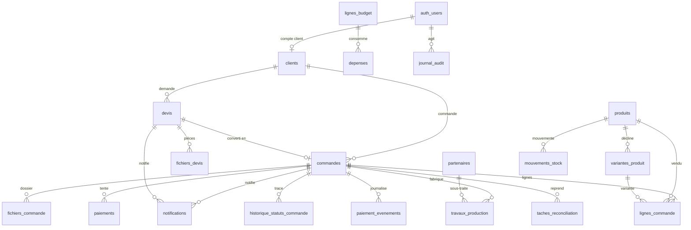

# Elembo — architecture Supabase et cycle commande-paiement-production

> Revue technique du 9 novembre 2026. Les migrations ont des identifiants uniques et ont été
> appliquées avec succès sur une instance Supabase **locale vierge** (PostgreSQL 15.19,
> Supabase CLI 3.0.0), y compris après un `supabase db reset`. Aucun projet Supabase distant
> n'a été modifié ; aucune donnée de production n'a été touchée.

## 1. Décision et principes

Supabase devient la **base de référence du commerce** : clients, devis, commandes, lignes,
fichiers, paiements, production, stock, dépenses, audit. Redis reste le **journal rapide des
transactions de paiement** et le support d'idempotence ; il n'est plus la base commerciale.

Quatre règles structurent l'ensemble :

1. **Le navigateur ne parle pas aux tables métier.** Les pages publiques et le back-office
   passent par des routes serveur Next.js. Le navigateur ne reçoit que la clé `anon`
   (authentification) ; la clé `service_role` reste exclusivement dans l'environnement serveur.
2. **Une commande existe avant le paiement.** Un paiement est un enfant d'une commande
   (`paiements.commande_id NOT NULL`) ; la base refuse une transaction orpheline.
3. **Le dossier de production ne dépend plus de l'onglet du client après paiement.** Les PNG,
   fiches et sources sont déposés dans un bucket privé **avant** l'initiation du paiement, puis
   rattachés à la commande. Le serveur peut les récupérer, les vérifier et les présenter à
   l'atelier même si le client a fermé son navigateur.
4. **Les prix restent une source unique et un statut explicite.** Les prix `TEST` et
   `PROVISOIRE` ne sont pas facturables ; la barrière serveur déjà livrée reste en place.

## 2. Migrations SQL versionnées

| Fichier | Contenu |
|---|---|
| `20261109130001_extensions_types.sql` | extension `pgcrypto`, énumérations métier |
| `20261109130002_tables.sql` | tables, clés étrangères, contraintes de cohérence |
| `20261109130003_fonctions_index.sql` | `updated_at`, machine à états commande/devis, synchronisation paiement, index |
| `20261109130004_rls_permissions.sql` | helpers de rôle, RLS, permissions `anon` / `authenticated` / `service_role` |
| `20261109130005_storage.sql` | buckets privés `devis` et `production`, refus d'accès direct |
| `20261109130006_seed_reference.sql` | produits, variantes, budget 500 000 FCFA, paramètres |

Application prévue :

```bash
# une fois le projet Supabase créé et lié
supabase link --project-ref <project-ref>
supabase db push --remote
```

Ou, sans CLI, exécuter les fichiers dans l'ordre dans l'éditeur SQL Supabase. La CLI est
préférable : elle enregistre l'historique des migrations.

### Ordre vérifié

| Version | Nom | État local |
|---|---|---|
| `20261109130001` | `extensions_types` | appliquée |
| `20261109130002` | `tables` | appliquée |
| `20261109130003` | `fonctions_index` | appliquée |
| `20261109130004` | `rls_permissions` | appliquée |
| `20261109130005` | `storage` | appliquée |
| `20261109130006` | `seed_reference` | appliquée |

`supabase migration list` confirme les six versions identiques en local et distant (local) ;
`supabase db reset` reconstruit la base de zéro sans erreur, applique les six migrations puis
`supabase/seed.sql` (no-op documentaire).

## 3. Relations entre les tables

```
auth.users
   │ 1
   │ 0..1 (compte client futur)
clients ───────────────< devis ───────────────< fichiers_devis
   │ 1                     │ 0..1
   │                        │
   │ N                      ▼
   └──────────────< commandes ───────────────< lignes_commande
                        │ 1                    │ N
                        │                      └── produits ──< variantes_produit
                        │ N
                        ├──< fichiers_commande
                        ├──< paiements
                        ├──< travaux_production >── partenaires
                        ├──< historique_statuts_commande
                        └──< mouvements_stock

produits ──< variantes_produit
produits ──< mouvements_stock
lignes_budget ──< depenses

auth.users ──< journal_audit
commandes / devis ──< notifications (entite, entite_id)

commandes ──< paiement_evenements (reference_id, commande_id)
commandes ──< taches_reconciliation (commande_id)
```

Tables de robustesse ajoutées :

- `paiement_evenements` : journal durable des callbacks/vérifications MTN, doublons comptés
  sans retraitement.
- `taches_reconciliation` : file de reprise (paiement en attente, paiement sans dossier,
  production sans tâche, notification échouée, fichier orphelin).

### Diagramme ER actualisé



Cardinalités qui comptent :

- `clients 1—N commandes` : un client peut commander plusieurs fois sans compte.
- `commandes 1—N lignes_commande` : chaque ligne porte produit, variante, quantité, prix et
  coût **figés** au moment de la commande.
- `commandes 1—N paiements` : plusieurs tentatives possibles, mais **un seul paiement `PAYE`**
  par commande (index unique partiel).
- `devis 0..1—1 commande` : un devis accepté peut produire une commande ; `commandes.devis_id`
  est unique.
- `commandes 1—N travaux_production` : une commande peut avoir plusieurs étapes (DTF, pressage,
  finition, montage, livraison), internes ou confiées à un partenaire.
- `commandes 1—N fichiers_commande` : visuels, fiche, BAT, facture, sources.

## 4. Tables et rôles métier

### Référentiels

| Table | Rôle | Points de vigilance |
|---|---|---|
| `produits` | catalogue commercial | `statut_prix` `TEST`/`PROVISOIRE`/`VALIDE` ; `VALIDE` exige `prix_fcfa`, `prix_valide_par_email` et `prix_valide_le` ; `disponible` distinct de `actif` |
| `variantes_produit` | tailles, couleurs, SKU, stock | stock initial à 0 et `stock_a_confirmer` dans le seed ; aucun stock inventé |
| `partenaires` | DTF, finitions, montage, livraison | tarifs, délais, historique via `travaux_production` |
| `parametres` | livraison, WhatsApp, budget, état du paiement | les clés publiques sont explicitement marquées `est_public` |

### Clients et devis

| Table | Rôle | Points de vigilance |
|---|---|---|
| `clients` | particulier ou entreprise | `user_id` optionnel ; email unique si présent ; téléphone normalisé |
| `devis` | demande de prestation | référence `DEV-…` ; statut `NOUVEAU` → `EN_ANALYSE` → `PROPOSE` → `ACCEPTE`/`REFUSE`/`EXPIRE` ; un devis `ACCEPTE` force `prix_valide` et `prix_verrouille` |
| `fichiers_devis` | visuels et cahiers des charges | bucket `devis`, types bornés, `verifie`/`verifie_le`, `expire_le` ; métadonnées seulement en base |

### Commandes et paiements

| Table | Rôle | Points de vigilance |
|---|---|---|
| `commandes` | objet central, créé avant paiement | `reference` unique `ELB-…` ; `statut`, `statut_paiement`, `statut_production`, `statut_livraison` séparés ; `design_snapshot` conservé pour régénération future |
| `lignes_commande` | produit, variante, quantité, prix, coût | prix et coût figés ; options JSON (format, support, bord, texte, couleur) |
| `fichiers_commande` | dossier de production | déposés avant paiement ; `verifie` passé à true après contrôle binaire serveur ; `expire_le` pour la conservation |
| `paiements` | transaction MTN/Airtel | `reference_id` UUID unique, `commande_id NOT NULL`, montant, statut, idempotence, payload brut |
| `paiement_evenements` | journal des callbacks/vérifications | `cle_evenement` unique, doublons comptés, `traite`, payload brut |
| `taches_reconciliation` | file de reprise | type, tentatives, prochaine tentative, dernière erreur |
| `historique_statuts_commande` | timeline | écrite par trigger à chaque transition |

### Production, stock, finances, audit

| Table | Rôle |
|---|---|
| `travaux_production` | étapes internes ou partenaires, coût, date prévue, statut |
| `mouvements_stock` | entrées, sorties, ajustements, pertes ; valorisation au coût |
| `lignes_budget` | budget de lancement : 415 000 opérationnels + 85 000 réserve protégée |
| `depenses` | dépenses par catégorie et ligne de budget, justificatif |
| `journal_audit` | acteur, action, entité, avant/après, date |
| `notifications` | outbox Telegram/email/WhatsApp, tentatives, erreur, idempotence |

## 5. Statuts et transitions

### Commande

```
BROUILLON
  → EN_ATTENTE_DE_VALIDATION
  → EN_ATTENTE_DE_PAIEMENT
  → PAYEE
  → A_PRODUIRE
  → EN_PRODUCTION
  → CONTROLE_QUALITE
  → PRETE
  → EN_LIVRAISON
  → LIVREE

Branches : ANNULEE, REMBOURSEMENT_A_TRAITER
```

Règles appliquées par la base :

- `PAYEE` est refusé si aucun `paiements.statut = 'PAYE'` n'existe pour la commande.
- `PAYEE` ne passe jamais directement à `EN_PRODUCTION` : il faut `A_PRODUIRE`.
- Une transition absente de `transition_commande_autorisee()` est refusée (`23514`), pas
  seulement par l'interface.
- Chaque transition écrit `historique_statuts_commande`.

### Paiement

`PENDING` → `PAYE` | `ECHEC` | `ANOMALIE` ; `PAYE` → `REMBOURSE`.

- Un trigger `AFTER UPDATE` synchronise `commandes.statut_paiement` et `paye_le`.
- Un `ECHEC` ou une `ANOMALIE` ne rétrograde jamais une commande déjà `PAYE`.
- L'index `paiements_un_seul_paye_par_commande` rend le double encaissement impossible.

### Devis

`NOUVEAU` → `EN_ANALYSE` → `PROPOSE` → `ACCEPTE` / `REFUSE` / `EXPIRE`.

- `ACCEPTE` exige `montant_propose_fcfa`.
- `ACCEPTE` verrouille le prix (`prix_verrouille = true`) : une modification ultérieure de la
  grille ne change pas le devis accepté.

### Tarification

`statut_prix` vaut `TEST`, `PROVISOIRE` ou `VALIDE`.

- Seul `VALIDE` est facturable en ligne. `TEST` et `PROVISOIRE` restent visibles comme
  « Prix sur demande » ou passent par un devis.
- La contrainte `produits_prix_valide_check` exige, pour `VALIDE`, un `prix_fcfa`, un
  `prix_valide_par_email` et un `prix_valide_le`. Une validation est donc un acte
  explicite et tracé, jamais une valeur par défaut.
- Aucun code ne doit passer automatiquement un prix de `TEST`/`PROVISOIRE` à `VALIDE` ; seule
  une action admin documentée le fait.
- Les frais de livraison suivent la même règle : la valeur `TEST` actuelle (100 FCFA) n'est pas
  la référence commerciale (1 000 / 2 000 FCFA). Ces montants seront configurés puis validés
  avant activation.
- Un devis accepté conserve son prix même si la grille change.

## 6. RLS et permissions

### Modèle d'accès

| Acteur | Accès |
|---|---|
| `anon` | lecture des produits `actif && disponible && statut_prix = 'VALIDE'` et des paramètres publics ; **aucune** table client/commande/devis |
| `authenticated` | lecture filtrée : staff selon rôle, client selon `clients.user_id` ; **aucune écriture directe** |
| `service_role` | écritures et lectures complètes, utilisé uniquement par les routes serveur Next.js |

Le back-office ne fait pas de requêtes Supabase depuis le navigateur. Chaque route `/admin`
vérifie d'abord la session et le rôle (`admin`, `commercial`, `atelier`, `finance`), puis utilise
le client service role. La RLS reste la seconde barrière si une clé `anon` est utilisée
directement.

### Matrice de lecture

| Table | admin | commercial | atelier | finance | client propriétaire |
|---|---|---|---|---|---|
| `clients` | oui | oui | oui | oui | oui |
| `produits` / `variantes` | oui | oui | oui | oui | produits validés seulement |
| `devis` / `fichiers_devis` | oui | oui | non | oui | oui |
| `commandes` / `lignes` / `fichiers` | oui | oui | oui | oui | oui |
| `paiements` | oui | non | non | oui | non |
| `travaux_production` / `partenaires` | oui | oui | oui | oui | non |
| `mouvements_stock` | oui | non | oui | oui | non |
| `depenses` / `lignes_budget` | oui | non | non | oui | non |
| `journal_audit` | oui | non | non | oui | non |
| `notifications` | oui | oui | non | non | non |
| `paiement_evenements` | oui | non | non | oui | non |
| `taches_reconciliation` | oui | non | non | oui | non |

Les écritures sont réservées à `service_role`. Les routes serveur appliquent en plus les règles
métier : un commercial ne peut pas modifier les dépenses, un atelier ne peut pas changer un
montant, un finance ne peut pas changer un statut de production.

### Fonctions d'aide

- `public.jwt_role()` lit `auth.jwt() -> 'app_metadata' ->> 'role'` (jamais `user_metadata`,
  modifiable par l'utilisateur).
- `public.has_role(text[])`, `public.is_staff()`.
- `public.commande_accessible(uuid)` et `public.devis_accessible(uuid)` évitent les récursions
  RLS pour les tables enfants.

### `app_metadata` et contournement de la RLS

- Le rôle staff vit dans `app_metadata`, que l'utilisateur ne peut pas modifier. Un test réel
  tente une élévation `commercial → admin` via `PUT /auth/v1/user` : le rôle reste `commercial`.
- `user_metadata` est ignoré par les policies et par `src/server/auth/roles.ts`.
- Les opérations qui utilisent `service_role` (écriture client/devis/commande/paiement,
  production, stock, dépenses, notifications, lectures admin) sont listées avec leur contrôle
  applicatif dans [`supabase-securite.md`](supabase-securite.md).
- Le garde `exigerRole()` est livré ; aucune route n'utilise encore `service_role`. Un test
  statique refuse une route qui mentionnerait `service_role` sans garde.
- Résultats des tests croisés clients/employés : [`supabase-securite.md`](supabase-securite.md).

## 7. Stockage des fichiers

Deux buckets privés :

| Bucket | Contenu | Taille max | Types |
|---|---|---|---|
| `devis` | cahier des charges, logo, visuel de référence | 25 Mo | PDF, PNG, JPEG, WEBP, ZIP |
| `production` | PNG d'impression, fiche, BAT, sources | 50 Mo | PDF, PNG, JPEG, JSON, TXT |

Aucune politique `anon` ou `authenticated` : l'accès direct est refusé. Le serveur délivre :

- une **URL signée d'envoi** après création du devis ou de la commande ;
- une **URL signée de téléchargement** après vérification du rôle et de l'appartenance.

Le fichier ne traverse jamais une fonction Vercel (limite 4,5 Mo) : le navigateur envoie
directement à Supabase Storage avec l'URL signée, puis le serveur enregistre les métadonnées et
vérifie l'objet.

Vérification réelle (signature binaire, taille, SHA-256), URL signées à durée limitée,
conservation et `design_snapshot` : [`fichiers-production.md`](fichiers-production.md).

Les anciens dossiers de production restent dans Vercel Blob (`fournisseur = 'VERCEL_BLOB'`) ;
les nouveaux utilisent Supabase Storage (`fournisseur = 'SUPABASE'`). La colonne
`fournisseur` rend la coexistence explicite et permet une migration progressive.

## 8. Flux devis (lot 2.2)

```
1. POST /api/devis
   → validation serveur (nom, contact, famille, besoin, quantité, spécifications)
   → upsert client (email/téléphone)
   → INSERT devis (statut NOUVEAU, référence DEV-…, idempotency_key)
   → réponse { reference, uploadUrls[] }

2. PUT direct navigateur → Supabase Storage (bucket devis, URL signée)

3. POST /api/devis/[reference]/fichiers
   → vérifie le devis, les types, tailles et l'existence de l'objet
   → INSERT fichiers_devis
   → marque le devis complet
   → INSERT notifications (Telegram Smart Vision + email client)

4. Confirmation au client
   → page avec référence, récapitulatif, prochaine étape
   → email si un fournisseur est configuré ; sinon notification visible dans l'admin
```

Points de sécurité :

- validation stricte des types et tailles côté serveur **et** dans le bucket ;
- chemin imposé `devis/<devis_id>/<uuid>-<nom>` ;
- aucun accès direct au bucket ;
- limitation de débit par IP et par adresse email (phase 3.3, avec la table
  `notifications`/Redis) ;
- la clé `service_role` n'est jamais envoyée au navigateur.

## 9. Flux commande-paiement-production (P0)

### 9.1 Commande avant paiement

```
1. POST /api/commandes
   → validation du panier et des coordonnées
   → recalcul du prix depuis les produits/options serveur
   → INSERT clients (ou réutilisation)
   → INSERT commandes (BROUILLON ou EN_ATTENTE_DE_PAIEMENT)
   → INSERT lignes_commande (prix et coûts figés)
   → réponse { commandeId, reference, totalFcfa, uploadUrls[] }

2. Le client génère ses PNG 300 dpi + fiche et les envoie directement
   → Supabase Storage bucket production
   → POST /api/commandes/[reference]/fichiers
   → vérification et INSERT fichiers_commande (verifie = true)

3. POST /api/momo/payer { commandeId, telephone, idempotencyKey }
   → exige une commande EN_ATTENTE_DE_PAIEMENT
   → exige au moins un VISUEL_IMPRESSION pour un produit textile/tableau
   → recalcule le montant depuis lignes_commande (jamais le navigateur)
   → INSERT paiements (PENDING, reference_id UUID, commande_id)
   → écrit le miroir Redis
   → appelle MTN requesttopay
```

Si l'envoi des fichiers échoue, **le paiement n'est pas initié** : le client peut réessayer.
Aucune commande payée ne peut donc rester sans dossier par fermeture d'onglet.

### 9.2 Paiement confirmé

```
callback MTN ou polling /api/momo/statut
  → journalise l'événement (paiement_evenements, doublons comptés)
  → vérifie le statut auprès de MTN
  → compare le montant au montant de la commande
  → UPDATE paiements SET statut = 'PAYE'
      → trigger : commandes.statut_paiement = 'PAYE', paye_le = now()
      → trigger : commandes.statut = 'PAYEE' si elle était EN_ATTENTE_DE_PAIEMENT
      → trigger : INSERT travaux_production (INITIALISATION, A_FAIRE)
  → INSERT notifications (atelier)
```

La tâche `INITIALISATION` est créée **dans la même transaction** que le paiement : même si le
serveur tombe juste après, l'atelier a une tâche. Le détail des callbacks dupliqués/tardifs, des
pannes Supabase et de la reprise est dans [`paiements-robustesse.md`](paiements-robustesse.md).

Idempotence :

- `paiements.reference_id` unique ;
- `paiements.idempotency_key` unique ;
- index unique partiel `un_seul_paye_par_commande` ;
- callback rejoué : si `paiements.statut` est déjà `PAYE`, aucun nouvel effet ;
- `POST /api/momo/payer` rejoué avec la même clé renvoie l'état existant ;
- réconciliation : les `PENDING` anciens sont interrogés, puis tranchés ; un `PAYE` sans dossier
  déclenche une alerte atelier.

### 9.3 Dossier de production récupérable

Le dossier est **pré-déposé** avant paiement. Après `PAYE`, le serveur peut :

- lister `fichiers_commande` et générer des URL signées pour l'atelier ;
- vérifier la présence d'au moins un visuel et de la fiche ;
- régénérer plus tard les fichiers depuis `commandes.design_snapshot` et les sources stockées
  (lot 3.4, avec un moteur de rendu serveur) ;
- alerter si un paiement `PAYE` n'a aucun fichier `verifie`.

Cela répond au P0 sans dépendre du navigateur après l'encaissement. La régénération graphique
serveur reste un objectif du lot 3.4, pas une condition du paiement.

## 10. Intégration Next.js

### Variables d'environnement

| Variable | Portée | Usage |
|---|---|---|
| `NEXT_PUBLIC_SUPABASE_URL` | navigateur + serveur | URL du projet |
| `NEXT_PUBLIC_SUPABASE_ANON_KEY` | navigateur + serveur | clé publique, limitée par RLS |
| `SUPABASE_SERVICE_ROLE_KEY` | **serveur uniquement** | écritures et stockage ; ne jamais exposer |
| `SUPABASE_STAGING_PROJECT_REF` | local / CLI | garde-fou du projet de test, non secret |
| `SUPABASE_ACCESS_TOKEN` | local / CLI | jeton de compte CLI, optionnel ; ne jamais committer |
| `SUPABASE_DB_URL` | serveur / CLI | migrations, scripts de maintenance (optionnel) |
| `SUPABASE_STORAGE_BUCKET_DEVIS` | serveur | `devis` |
| `SUPABASE_STORAGE_BUCKET_PRODUCTION` | serveur | `production` |
| `RESEND_API_KEY` | serveur | confirmation client, si activé (optionnel) |

`SUPABASE_SERVICE_ROLE_KEY` ne doit jamais apparaître dans un composant `'use client'`, dans une
variable `NEXT_PUBLIC_*`, dans un log ou dans une réponse HTTP.

### Modules serveur prévus

```
src/server/db/client.ts          client service role, import 'server-only'
src/server/db/types.ts           types générés depuis le schéma
src/server/repositories/*.ts     clients, devis, commandes, paiements, production
src/server/auth/roles.ts         lecture du rôle, garde serveur
src/server/storage/supabase.ts   URL signées envoi/téléchargement
src/server/notifications/*.ts    outbox Telegram / email
src/app/api/devis/*              routes publiques de devis
src/app/api/commandes/*          routes de commande et de fichiers
src/app/api/admin/*              routes protégées du back-office
```

Aucun composant React n'exécute de SQL. Les repositories sont testables avec une base de test.

### Authentification et rôles

- Supabase Auth (email/mot de passe + magic link) pour le staff.
- Rôle stocké dans `auth.users.raw_app_meta_data.role` (`app_metadata`), jamais dans
  `user_metadata`.
- Un layout `/admin` vérifie la session **côté serveur** ; chaque route API refait la
  vérification. Le middleware seul ne suffit pas.
- Rôles : `admin`, `commercial`, `atelier`, `finance`.

## 11. Plan d'intégration et lots

| Étape | Contenu | Dépend de |
|---|---|---|
| 3.1a | création du projet Supabase, variables, application des 6 migrations | accès projet |
| 3.1b | clients serveur, repositories, `/api/sante` avec `select 1` | 3.1a |
| 3.1c | tests RLS (anon/authenticated/service_role) sur base de test | 3.1a |
| 2.2 | formulaire devis, upload signé, persistance, notifications | 3.1b |
| 3.2 | création de commande avant paiement, refactor `/api/momo/payer` | 3.1b |
| 3.2b | pré-dépôt des fichiers de production, contrôle de complétude | 3.2 |
| 3.3 | auth staff, rôles, back-office commandes/devis/clients | 3.1c |
| 3.4 | production, partenaires, BAT, régénération serveur | 3.2b, 3.3 |
| 4.x | coûts, dépenses, marges, stock, budget, rapports | 3.x |

## 12. Tests exécutés

### Base et RLS (instance locale vierge)

- `supabase db reset` : 6 migrations appliquées, aucune erreur ;
- `supabase migration list` : versions `20261109130001` → `20261109130006` alignées ;
- `anon` ne lit pas `clients`, `commandes`, `devis`, `paiements` ;
- `anon` lit uniquement les produits `VALIDE` ;
- `commercial` lit les commandes, pas les paiements/dépenses ;
- `atelier` lit les commandes et la production, pas les paiements/dépenses ;
- `finance` lit paiements/dépenses, pas les notifications ;
- `admin` lit paiements/dépenses/journal d'audit ;
- `authenticated` ne peut pas écrire directement ;
- client A ne lit pas les commandes de client B ;
- `app_metadata` ne peut pas être élevé par l'utilisateur.

Résultat : `tests/supabaseRls.integration.test.ts` (5) +
`tests/supabaseLifecycle.integration.test.ts` (13) = **18 tests verts** sur base locale.
`tests/supabaseSchema.test.ts` ajoute 14 garde-fous statiques. Total Supabase : **32 tests**.
`tests/routesSecurite.test.ts` ajoute 7 tests de routes API et de garde `service_role`.

### Nettoyage

`scripts/verifier-nettoyage-supabase.mjs` : 0 client, 0 commande, 0 produit, 0 dépense et
0 utilisateur Auth de test après la suite.

### Domaine

- paiement d'un montant différent du total refusé ;
- `PAYEE` sans paiement refusé ;
- un seul paiement `PAYE` par commande ;
- `PAYE` crée `travaux_production INITIALISATION` ;
- transition `PAYEE → EN_PRODUCTION` refusée ;
- devis `ACCEPTE` sans montant refusé ;
- prix `VALIDE` exige un acteur et une date de validation ;
- upload hors type/taille : règles livrées, tests d'intégration au lot 3.2b.

### Recette globale

- `npm test` : **407 tests passés, 18 ignorés** sans projet Supabase de test ;
- avec `SUPABASE_TEST_*` : **425 tests passés, 0 ignorés** ;
- `npm run lint` : 0 erreur, 2 avertissements préexistants ;
- `npm run build` : OK, Next.js 16.3.6 ;
- aucun paiement réel, aucune clé de production modifiée.

## 13. Décisions à valider

1. **Auth staff** : Supabase Auth (recommandé) ou Auth.js avec un provider existant ?
2. **Stockage** : Supabase Storage pour les nouveaux fichiers, Vercel Blob conservé pour
   l'historique — cette coexistence est-elle acceptée ?
3. **Confirmation client** : email transactionnel via Resend, ou WhatsApp manuel au lancement ?
   Sans fournisseur configuré, la notification est enregistrée dans l'outbox et visible dans
   l'admin, jamais annoncée comme envoyée.
4. **Clientèle** : commande sans compte au lancement (recommandé), comptes clients en phase 5 ?
5. **Régénération serveur** : pré-dépôt des fichiers avant paiement (livré au lot 3.2b) et
   régénération depuis `design_snapshot` au lot 3.4 — acceptable ?
6. **Prix commerciaux** : nécessaires pour ouvrir le paiement en ligne ; sans eux, le tunnel
   reste fermé et les devis prennent le relais.

## 14. État réel après la revue

- Migrations appliquées et testées sur une instance **locale** ; aucun projet Supabase hébergé
  n'est encore lié, aucune migration distante exécutée.
- Aucun code applicatif Supabase (client, repositories, routes) : il dépend de la validation du
  schéma et de l'accès au projet.
- Tests RLS et cycle de vie exécutés en local ; ils doivent être rejoués sur le projet de test
  hébergé avant toute mise en production.
- Vérification binaire des fichiers, URL signées et politique de conservation : règles et
  colonnes livrées, routes non encore branchées (lot 3.2b).
- `paiement_evenements` et `taches_reconciliation` existent ; le worker de réconciliation reste
  à brancher au lot 3.2.
- Aucun prix `VALIDE` dans le seed : les produits restent `TEST`/`PROVISOIRE`, le paiement en
  ligne reste fermé. Aucune donnée commerciale inventée.
- Aucune fonctionnalité existante supprimée ; la vitrine et le paiement MTN de production n'ont
  pas été modifiés.
